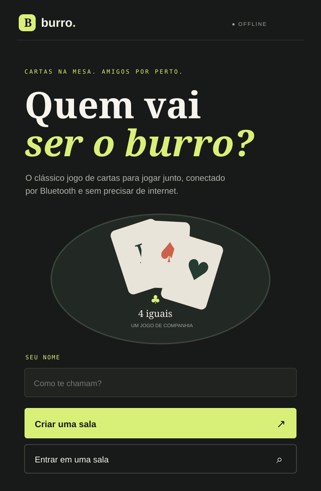
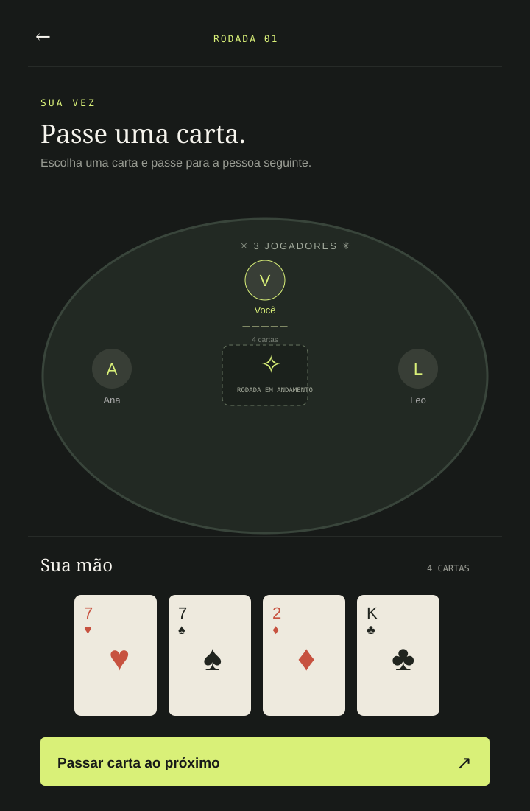

# Burro — cartas & companhia

Jogo mobile de cartas para uma mesa de 2 a 6 pessoas. Os aparelhos próximos se encontram e trocam o estado da partida por Bluetooth Low Energy (BLE); a partida não depende de internet. A aplicação usa Vue, Ionic e Capacitor.

> Estado desta entrega: primeira implementação do projeto e documentação. O bundle web foi compilado e sincronizado com o projeto Android; ainda falta compilar o APK e validar a partida em aparelhos físicos. Os dados da turma e o link público do GitHub são campos para preencher antes da entrega acadêmica.

## Identificação acadêmica

- **Curso:** `[preencher com o nome oficial do curso]`
- **Unidades Curriculares:**
  - Codificar acesso à web services e recursos de sistemas móveis.
  - Codificar aplicações para dispositivos móveis.
- **Indicadores trabalhados:**
  - *Codificar acesso à web services e recursos de sistemas móveis:* integra recursos nativos do dispositivo conforme as necessidades do aplicativo e características do sistema mobile; aplica correções e melhorias após validar e depurar a integração.
  - *Codificar aplicações para dispositivos móveis:* aplica recursos da biblioteca do sistema mobile; programa persistência local de dados utilizando arquivos e banco de dados portáveis conforme as necessidades do sistema.
- **Integrantes:** `[nome]` — [GitHub](https://github.com/SEU_USUARIO) · `[adicionar demais integrantes]`
- **Repositório público:** `[publicar este projeto e substituir pelo link]`

## Como jogar

1. Instale o APK nos celulares Android que vão jogar. A tela aberta por `npm run dev` é apenas uma prévia de interface; ela não acessa o Bluetooth nativo do celular.
2. O anfitrião informa o nome e cria a sala. Conceda as permissões Bluetooth quando o Android solicitar. O anfitrião anuncia a sala; os demais buscam pelo código Bluetooth e solicitam entrada.
3. O anfitrião aceita de 1 a 5 convidados e inicia a partida. O baralho de 52 cartas é embaralhado e cada pessoa recebe quatro cartas.
4. Em ordem, cada pessoa escolhe uma carta e confirma. Depois que todos escolherem, o app passa as cartas ao mesmo tempo no sentido horário. Cada pessoa recebe a carta de quem estava à sua direita e mantém quatro cartas.
5. As cartas recebidas permanecem na mão nas próximas trocas. Ao formar quatro cartas do mesmo valor, o jogador completa o quarteto e vence a rodada.
6. Todos têm cinco segundos para tocar **Percebi!**. O último a reagir recebe uma letra de **BURRO**; quem completar a palavra é eliminado. A partida termina quando resta uma pessoa. O histórico do resultado fica salvo nos celulares.

As regras e o protocolo da primeira versão estão descritos em [docs/REGRAS.md](docs/REGRAS.md) e [docs/PROTOCOLO_BLUETOOTH.md](docs/PROTOCOLO_BLUETOOTH.md).

O projeto também permite adicionar participantes locais na sala para experimentar as rodadas em um só aparelho. Essa modalidade é uma prévia de interface e não substitui a validação multiplayer por Bluetooth.

## Executar e compilar

Requisitos: Node.js LTS, npm, Android Studio/SDK para gerar o app Android, e dois ou mais celulares com Bluetooth LE para validar a comunicação entre aparelhos.

```bash
npm install
npm run dev
```

Para preparar Android:

```bash
npm install
npx cap add android
npm run build
npx cap sync android
npx cap open android
```

No Android Studio, compile e instale o app em cada aparelho. Permita Bluetooth para buscar ou anunciar salas. Para testar Bluetooth, todos precisam abrir o **app instalado**, não o endereço local do Vite no navegador.

## Prévia da interface

As imagens abaixo são ilustrações de interface do projeto, não capturas de uma execução validada em celular. Substitua-as ou complemente-as com capturas reais do app antes da entrega.





## Desenvolvimento e contribuição

1. Faça um fork do repositório público e clone seu fork.
2. Crie uma branch para a alteração: `git switch -c feat/minha-melhoria`.
3. Instale as dependências e execute `npm run dev` para trabalhar na interface.
4. Para validar integração Bluetooth, compile no Android, instale em aparelhos separados e teste descoberta, entrada na sala, início da rodada, passagem de carta, desconexão e reconexão.
5. Atualize este README e o checklist quando uma funcionalidade mudar. Abra um pull request com resumo e evidências visuais.

## Persistência e dados

O perfil local e o histórico curto de partidas ficam no armazenamento local do navegador/WebView (`localStorage`). As cartas e o estado da rodada ficam em memória durante o jogo; a mão é enviada ao aparelho correspondente quando há vínculo de jogador BLE. A aplicação não possui conta, servidor, API web nem sincronização remota. Isso mantém a demonstração independente de internet; uma futura necessidade de histórico grande ou exportação pode justificar uma base SQLite portátil.

## Limitações conhecidas

- BLE depende das permissões, do suporte BLE e das diferenças de fabricante/versão do sistema. A descoberta, aceitação e troca de cartas ainda precisam de demonstração em dois celulares reais; a prévia web não oferece BLE.
- O transporte BLE usa uma mensagem JSON simples e ainda não tem criptografia, autenticação de sala, confirmação robusta de entrega ou recuperação automática de uma partida após queda do anfitrião.
- A regra de penalidade não está definida no PDF; o app usa por padrão último a reagir em cinco segundos. Combine essa decisão com o grupo/docente antes da avaliação.
- A desconexão é exibida, mas pausa e reconexão durante uma partida ainda precisam ser concluídas.
- Não há serviço web remoto: o requisito do jogo privilegia Bluetooth local e funcionamento sem internet. Se a avaliação exigir uma API web independente do documento anexado, será necessário definir esse serviço.
- Ainda não foi gerado APK nem gravado GIF/captura de execução real.

## Checklist de funcionalidades

| Funcionalidade | Estado | Observação |
|---|---|---|
| Interface mobile em Vue, Ionic e Capacitor | ✅ Implementada | Adaptada para telas estreitas e largas. |
| Criar sala e cadastrar de 2 a 6 participantes | ✅ Implementada | Inclui participantes locais para demonstração da lógica. |
| Baralho, quatro cartas e troca simultânea à esquerda | ✅ Implementada | As mãos mantêm quatro cartas e seguem entre rodadas. |
| Confirmar quartetos, reação e eliminar quem completa BURRO | ✅ Implementada | Regra padrão documentada em `docs/REGRAS.md`. |
| Buscar sala, solicitar entrada, aceitar ou recusar | 🟡 Parcial | Fluxo BLE implementado; requer demonstração em dois celulares. |
| Trocar estado entre aparelhos e enviar mão privada | 🟡 Parcial | GATT e validações implementados; sincronização real ainda não foi demonstrada. |
| Solicitar permissões de Bluetooth | ✅ Implementada | Por meio do plugin nativo. |
| Histórico persistente no dispositivo | ✅ Implementada | `localStorage`, sem servidor remoto. |
| Banco SQLite portátil | ⬜ Não desenvolvido | Não necessário para o histórico curto atual; avaliar se exigido pela UC. |
| Serviço/API web remoto | ⬜ Não desenvolvido | O escopo do jogo pede funcionamento Bluetooth sem internet. |
| APK Android e demonstração real em dois celulares | 🟡 Parcial | APK de depuração instalado no celular conectado; falta a partida com segundo celular. |
| README, instruções e prévias ilustrativas | ✅ Implementada | Substituir campos acadêmicos e prévias por evidências reais. |

## Tecnologias

- Vue 3, Ionic Vue e Vite.
- Capacitor 8 para empacotamento Android.
- `@capgo/capacitor-bluetooth-low-energy` para BLE central/periférico, GATT e permissões.
- `localStorage` para preferências e histórico no dispositivo.
